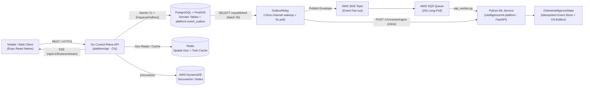
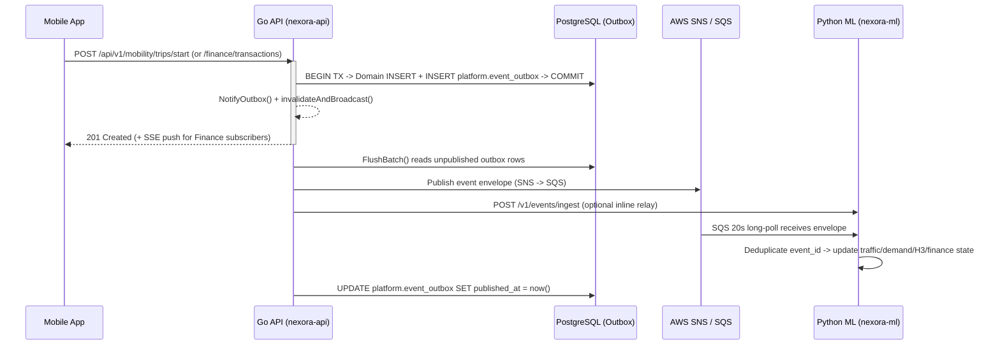

# NEXORA

Intelligent life platform unifying **Mobility (MoveSmart)**, **Wealth & Finance**, **Copilot**, **Health**, and **Work** on an event-driven architecture.

## Architecture Overview

NEXORA separates **transactional state and control plane** (Go + PostgreSQL/PostGIS + Redis) from **online learning and inference** (Python + FastAPI), connected asynchronously through a **Transactional Outbox → AWS SNS/SQS (or local relay) → Online Intelligence Consumer** pipeline, with **Server-Sent Events (SSE)** for real-time client updates.



## Event-Driven Flow

1. **Atomic Write + Outbox Enqueue (`platform/api`)**
   - Every domain mutation (`mobility/repository.go`, `finance/repository.go`) writes its business row and calls `events.EnqueueOutbox(...)` inside the **same PostgreSQL transaction**, guaranteeing zero lost events on crash.
   - `EnqueueOutbox` inserts into `platform.event_outbox` and calls `NotifyOutbox()` (non-blocking buffered channel) to wake `OutboxRelay` immediately (`<5 ms`), backed by a 5-second fallback ticker.

2. **Relay & Envelope Wrapping (`platform/api/internal/platform/events/outbox.go`)**
   - `OutboxRelay.FlushBatch` reads up to 25 unpublished rows (`published_at IS NULL AND attempts < 10`), wraps each in the standard `contracts/events/envelope.schema.json` format (`event_id`, `event_type`, `schema_version`, `occurred_at`, `ingested_at`, `producer`, `payload`), and delivers it to:
     - **AWS SNS** (`SNS_EVENTS_TOPIC_ARN`, SigV4-signed HTTPS `Publish` with `event_type` attribute) → **AWS SQS** (`SQS_INTELLIGENCE_QUEUE_URL`).
     - **ML HTTP Ingestion** (`POST /v1/events/ingest`) when `ML_SERVICE_URL` is configured for sub-second local/direct propagation.
   - Failed deliveries increment `attempts` and record `last_error` for retry; successful deliveries stamp `published_at`.

3. **Idempotent Online Intelligence (`intelligence/ml-platform/src/nexora/events/sqs_worker.py`)**
   - `run_sqs_consumer_loop` long-polls SQS (`WaitTimeSeconds=20`, `MaxNumberOfMessages=10`) while `/v1/events/ingest` accepts direct HTTP relays.
   - `OnlineIntelligenceState.handle_event` deduplicates via `event_id`, unwraps SNS envelopes if present, routes by `event_type`, checkpoints state to disk, and updates live models in memory:
     - `traffic.observed.v1` → updates `SpatioTemporalTrafficForecaster` segment speeds
     - `location.observed.v1` / `location.batch` → cleans trajectories, indexes H3 cells, updates `MobilityDemandForecaster` & hotspot discovery
     - `trip.started.v1` / `trip.completed.v1` / `route.feedback.v1` → updates demand & route quality feedback
     - `hazard.reported.v1` → updates active road hazard ring buffer
     - `finance.transaction.ingested.v1` → feeds cross-domain finance event stream

4. **Cache Invalidation & Real-Time UI Push (`Redis` + `SSE`)**
   - Finance mutations call `invalidateAndBroadcast(ctx, userID, event)`, which deletes the cached snapshot (`fin:twin:v1:<userID>`) in Redis and pushes an event onto per-user subscriber channels streamed over `GET /api/v1/finance/stream` (SSE).
   - Mobility trip breadcrumbs update Redis spatial geo sets for low-latency nearby active-trip radar queries.



### Event Contracts (`contracts/events/`)

| Event | Producer | Consumer Effect |
|---|---|---|
| `trip.started.v1` | Mobility Repository | Seeds H3 demand ping at trip origin |
| `location.observed.v1` | Mobility Repository | Trajectory cleaning, H3 hotspot & demand updates |
| `trip.completed.v1` | Mobility Repository | Trip telemetry completion & duration metrics |
| `route.feedback.v1` | Mobility Repository | Route recommendation feedback loop |
| `hazard.reported.v1` | Mobility Repository | Updates active corridor hazard buffer |
| `traffic.observed.v1` | Mobility Telemetry | Updates spatio-temporal segment speed state |
| `transit.updated.v1` | Transit Feed | Updates stop arrival / freshness signals |
| `prediction.generated.v1` | Intelligence Service | Records generated forecast metadata |
| `finance.transaction.ingested.v1` | Finance Repository | Streams new financial activity to ML & SSE |
| `work.task.created.v1` | Work Module | Task lifecycle envelope |

---

## Tech Stack

| Layer | Technology |
|---|---|
| Mobile / Web | React Native (Expo) + TypeScript + React Query + Zustand |
| Control-Plane API | Go + Chi modular monolith (`platform/api`) |
| Intelligence & ML | Python + FastAPI + PyTorch (`intelligence/ml-platform`) |
| Primary DB | PostgreSQL 16 + PostGIS (per-module schemas + transactional outbox) |
| Cache & Geo | Redis 7.4 |
| Event Bus | PostgreSQL Outbox → AWS SNS / SQS (or Redpanda/Kafka locally) |
| Document Store | AWS DynamoDB (serverless HTTPS) |
| Object Storage | MinIO (local) / S3-compatible |
| Observability | Prometheus + Grafana |

## Repository Layout

```
apps/mobile/                Expo React Native app (Home, Explore, Copilot, Profile + Mobility & Wealth workspaces)
platform/api/               Go modular monolith API (platform, identity, outbox, cache, mobility, finance)
intelligence/ml-platform/   FastAPI ML inference service, SQS event consumer, geospatial & finance engines
contracts/                  OpenAPI v1 spec (contracts/openapi/) + JSON event schemas (contracts/events/)
infra/                      AWS SAM/Docker deploy templates, Postgres, Prometheus, Grafana configs
scripts/                    Deployment & ops helper scripts (deploy-aws.sh)
docs/                       Architecture blueprint, ADRs, runbooks
```

---

## Quick Start

### 1. Local Full Stack (Docker Compose)

```bash
cp .env.example .env
make up           # starts postgres, redis, redpanda, minio, api (:8080), ml (:8000), prometheus (:9090), grafana (:3000)
make ps

# Health checks
curl http://localhost:8080/api/v1/healthz
curl http://localhost:8000/healthz
```

### 2. Run Mobile / Web Client

```bash
cd apps/mobile
npm install
npm run web       # or npm run ios / npm run android
```

### 3. Tests & Formatting

```bash
make api-test     # cd platform/api && go test ./...
make ml-test      # cd intelligence/ml-platform && python -m pytest
make fmt          # cd platform/api && go fmt ./...
```

### 4. AWS Free-Tier Deployment

Requires `.env.aws` (see `infra/aws/env.aws.example`):

```bash
make aws-deploy   # provisions/updates stack & deploys api + ml
make aws-status
make aws-logs
```

## Conventions

- **Contracts first:** `contracts/openapi/nexora-v1.yaml` and `contracts/events/` are the sources of truth.
- **Boundary separation:** Go owns business logic, persistence, and outbox transactions; Python owns inference and online learning.
- **Privacy by design:** Never log raw GPS coordinates, bank account numbers, PAN, Aadhaar, or unmasked UPI IDs.
