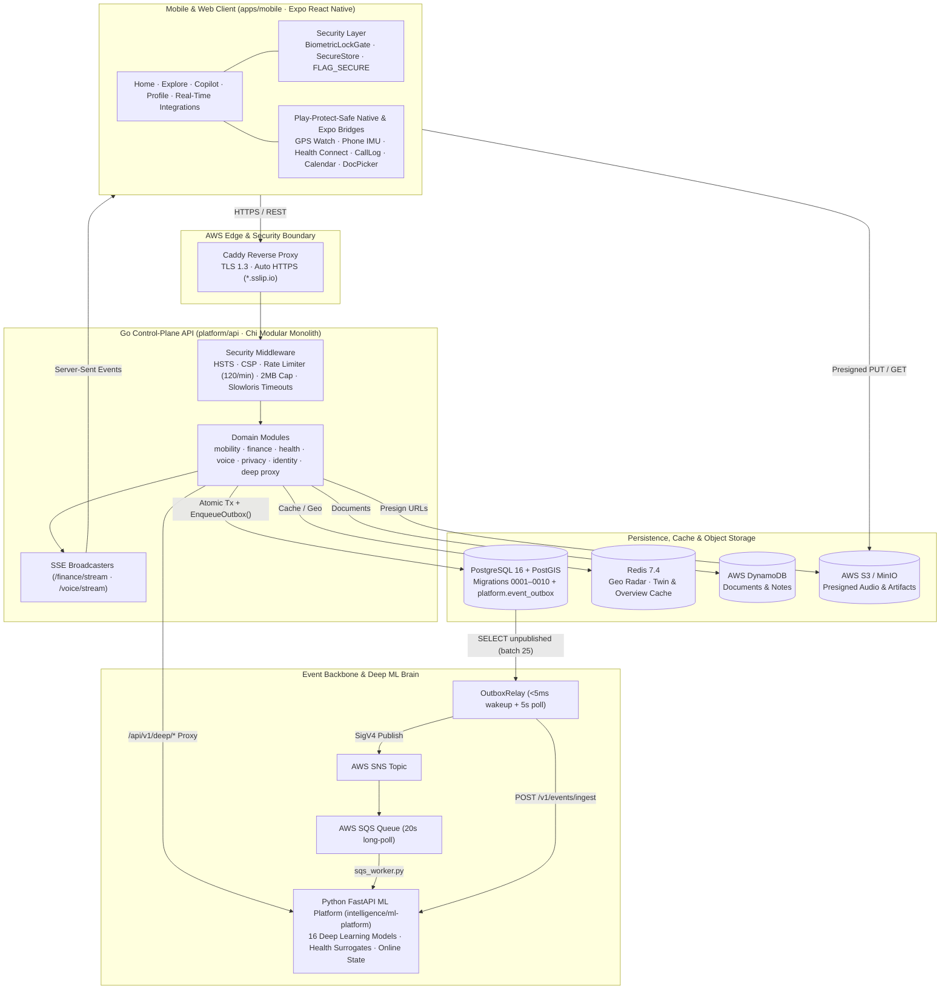
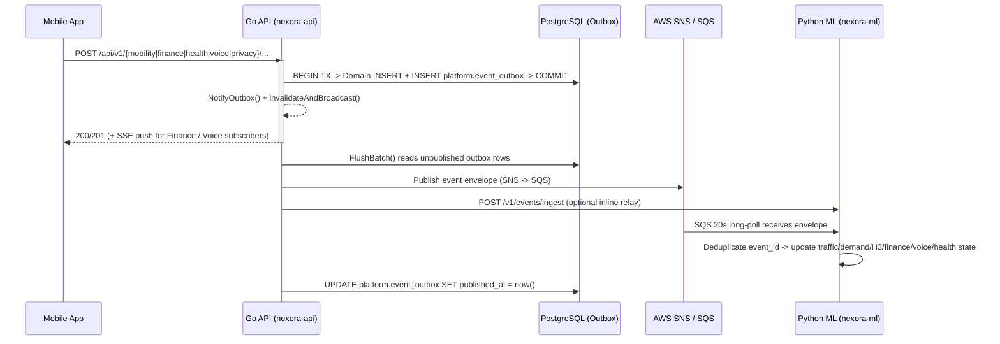

# NEXORA

**NEXORA** is a privacy-first personal intelligence operating system unifying **Mobility (MoveSmart)**, **Wealth & Finance**, **Health & Sleep-Related Brain Clearance**, **Voice & Call Notes**, and **Cross-Domain Copilot** on an event-driven, zero-trust architecture.

---

## 1. High-Level Design (HLD)

NEXORA separates **transactional state, security enforcement, and control plane** (`platform/api`: Go + Chi + PostgreSQL/PostGIS + Redis) from **online learning and deep inference** (`intelligence/ml-platform`: Python + FastAPI + PyTorch), bridged by a **Transactional Outbox → AWS SNS/SQS (or inline HTTP relay) → Idempotent Intelligence Consumer** pipeline, with **Server-Sent Events (SSE)** for real-time client updates.



---

## 2. Core Domain Modules

### 1. Mobility — MoveSmart (`platform/api/internal/modules/mobility`, `apps/mobile/src/features/move`)
- Turn-by-turn multimodal routing, live corridor telemetry, traffic anomaly detection, road hazard reporting, and H3 spatial hotspot & demand forecasting (`traffic_forecaster.py`, `demand_forecaster.py`, `eta_engine.py`, `city_digital_twin.py`).
- Privacy-preserving crowd telemetry (`POST /api/v1/move/privacy/telemetry`) with k-anonymity cell suppression ($k=3$) and Laplace differential privacy ($\varepsilon=1.0$).

### 2. Wealth & Finance (`platform/api/internal/modules/finance`, `apps/mobile/src/features/finance`)
- Financial Digital Twin, multi-account ledger, Account Aggregator (`Sahamati / Finvu`) channel & consent orchestration (`android_sms`, `ios_shortcut`, `email_forward`, `manual_import`), tax regime & LRS planning, AI CFO synthesis, Redis twin cache invalidation (`fin:twin:v1:<userID>`), and real-time SSE push (`/api/v1/finance/stream`).
- Zero-permission CSV/PDF statement picker (`expo-document-picker`) in Integrations.

### 3. Health & Sleep-Related Brain Clearance (`platform/api/internal/modules/health`, `apps/mobile/src/features/health`)
- **Submodules**: Health Hub (`HealthHubScreen`), Live Sensors (`SensorStreamScreen`), Sleep & Clearance (`SleepClearanceScreen`), and MRI Cohort Validation (`MriValidationScreen`) with interactive visualizations (`HealthVisualizations.tsx`).
- **Sensor & Wearable Ingestion**: Phone accelerometer/gyroscope ring buffer (`NexoraHealthSensorsModule.kt`, `25 Hz`), ambient light (`LightSensor`), step counter (`Pedometer`), and **Health Connect** (`HeartRateRecord`, `HeartRateVariabilityRmssdRecord`, `RespiratoryRateRecord`, `SleepSessionRecord`, `StepsRecord`, `OxygenSaturationRecord`) / Apple HealthKit.
- **Scientific Guardrails**: Every surrogate prediction (`dti_alps_index`, `csf_pulsatile_velocity_cm_s`, `clearance_efficiency_score`) enforces provenance metadata, uncertainty intervals, and explicit claim guardrails (`migrations/0008`–`0009`).

### 4. Voice & Call Notes (`platform/api/internal/modules/voice`, `intelligence/ml-platform/src/nexora/voice`)
- **Capture & Streaming**: Quick notes, presigned S3 audio uploads (`s3_presign.go`), dual-track live sessions (`/voice/sessions/*`), and downloadable transcript/audio artifacts (`GET /api/v1/voice/conversations/{id}/download`).
- **Speech & Understanding**: VAD/SNR routing (`audio_pipeline.py`), speaker clustering (`speech_engine.py`), commitments/decisions/knowledge graph extraction, contradiction reasoning, and source-grounded Q&A (`understanding_engine.py`, `ir.py`).
- **Native Caller ID & Calendar**:
  - Phone numbers are SHA-256 hashed and masked (`caller_directory.go`, `call_logs.go`) before persistence in `voice.caller_directory` and `voice.call_logs`.
  - **Android**: `READ_CALL_LOG` historic call sync + `CallScreeningService` (`NexoraCallerIdModule.kt`, `withNexoraCallerId.js`).
  - **iOS**: `CNContactStore` contacts sync + CallKit `CXCallDirectoryProvider` & `CXCallObserver`.
  - **Calendar**: 24-hour upcoming event context (`expo-calendar`) after explicit user grant.
- **Cryptographic Provenance**: SHA-256 digest, HMAC seal, utterance Merkle root, hash-chained `voice.custody_events`, and Legal Hold controls (`crypto.go`).

### 5. Privacy & Permissions (`platform/api/internal/modules/privacy`, `apps/mobile/src/core/permissions`)
- Server-persisted per-user permission matrix and append-only consent audit trail (`POST/GET /api/v1/privacy/permissions`, `0010_user_privacy_permissions`).
- **Real-Time Integrations Hub** (`apps/mobile/src/features/integrations`, `useRealtimeIntegrations.ts`): Unified consent-gated sync engine with continuous GPS watching (`Location.watchPositionAsync`), active phone IMU burst ingestion, Health Connect sync, and Call Log + Calendar ingestion.

### 6. Cross-Domain Copilot & Deep Intelligence Studio (`apps/mobile/src/features/assistant`, `apps/mobile/src/features/explore`)
- **Copilot**: Unified conversational assistant across Mobility, Wealth, Health, Voice, and Work with explainability factors and privacy-gated context toggles.
- **Deep Intelligence Studio**: Direct interface to the 16 deep learning architectures with business-impact framing and shadow-mode evaluation.

---

## 3. Unified Deep Learning Platform (`intelligence/ml-platform/src/nexora/deep_learning`)

| Domain | Models & Endpoints (`/api/v1/deep/...` → `/v1/deep/...`) |
|---|---|
| **Mobility** | `SpatioTemporalGNN` (`st-gnn/predict`), `DeepConformalETAPredictor` (`eta/conformal`), `TrajectoryTransformer` (`trajectory/predict`), `TripAnomalyAutoencoder`, `NeuralRoadVision` (`vision/inspect`), `BehavioralDemandTFT` (`demand/forecast`), `OfflineRLPolicySimulator` (`policy/evaluate`) |
| **Finance** | `NeuralTransactionClassifier` (`classify-alert`), `DeepSVDDAnomalyDetector` (`anomaly`), `DeepARCashFlowForecaster` (`cashflow-forecast`), `RegimeSwitchingRiskModel` (`regime-risk`), `GNNRiskPropagator` (`graph/propagate`), `NeuralDocIntelligence` (`doc/extract`) |
| **Voice** | `WhisperTelephonyASRAdapter` (`asr/adapt`), `NeuralSpeakerDiarizer` (`diarize`), `DenseMemoryRetriever` (`dense-search`), `CrossEncoderReranker` (`rerank`), `AcousticUrgencyEmotionDetector` (`urgency`) |
| **Cross-Cutting** | `MultiModalUserTwinFusion` (`multimodal/user-twin`), `DriftDetector` (`evaluation/drift`), `ModelEvaluationHarness` (`intelligence/evaluation/benchmark.py`) |

---

## 4. Security & Privacy Design

### Mobile Client Hardening (`apps/mobile/src/core/security`)
- **Biometric Vault Lock** (`BiometricLockGate.tsx` + `expo-local-authentication`): Locks the app on background return when enabled in Profile, requiring Face ID / Touch ID / Android Biometrics.
- **Hardware-Backed Secret Storage** (`appSecurity.ts` + `expo-secure-store`): Stores security flags and sensitive keys in Android Keystore / iOS Keychain (`WHEN_UNLOCKED_THIS_DEVICE_ONLY`).
- **Screen & Recording Shield** (`expo-screen-capture`): Enables Android `FLAG_SECURE` to block screenshots and app-switcher previews.
- **Play-Protect-Safe Permissions**: Excludes sideloading-blocked permissions (`READ_SMS`, `RECEIVE_SMS`, `BIND_NOTIFICATION_LISTENER_SERVICE`, `BIND_ACCESSIBILITY_SERVICE`); all device access (`Location`, `READ_CALL_LOG`, `Health Connect`, `Calendar`) runs strictly after explicit user grant.

### Backend API Hardening (`platform/api/internal/bootstrap/security.go`, `cmd/server/main.go`)
- **Security Headers**: `Strict-Transport-Security`, `Content-Security-Policy: default-src 'none'; frame-ancestors 'none'`, `X-Content-Type-Options: nosniff`, `X-Frame-Options: DENY`, `Referrer-Policy: no-referrer`, and `Cache-Control: no-store` on `/api/*`.
- **Rate Limiting & DoS Protection**: Per-IP token-bucket limiter (`120 req/min`, burst `40`, `429 Retry-After`), `2 MB` `MaxBytesReader` payload cap, and Slowloris HTTP timeouts (`ReadHeaderTimeout: 5s`, `IdleTimeout: 60s`, `MaxHeaderBytes: 64 KB`).
- **PII Protection**: Raw GPS trajectories, phone numbers, bank account numbers, PAN, Aadhaar, and unmasked UPI IDs are never logged or stored in plaintext.

---

## 5. Event-Driven Outbox & Real-Time Flow



### Event Contracts (`contracts/events/`)

| Event | Producer | Consumer Effect |
|---|---|---|
| `trip.started.v1` | Mobility Repository | Seeds H3 demand ping at trip origin |
| `location.observed.v1` | Mobility Repository | Trajectory cleaning, H3 hotspot & demand updates |
| `trip.completed.v1` | Mobility Repository | Trip telemetry completion & duration metrics |
| `route.feedback.v1` | Mobility Repository | Route recommendation feedback loop |
| `hazard.reported.v1` | Mobility Repository | Updates active corridor hazard buffer |
| `traffic.observed.v1` | Mobility Telemetry | Updates spatio-temporal segment speed state |
| `transit.updated.v1` | Transit Feed | Updates stop arrival / freshness signals |
| `prediction.generated.v1` | Intelligence Service | Records generated forecast metadata |
| `finance.transaction.ingested.v1` | Finance Repository | Streams new financial activity to ML & SSE |
| `voice.recording.captured.v1` | Voice Repository | Records new voice/call capture metadata |
| `voice.audio.analyzed.v1` | Voice Pipeline | Publishes VAD/SNR acoustic quality metrics |
| `voice.speech.transcribed.v1` | Voice Pipeline | Publishes speaker-attributed utterances |
| `voice.conversation.understood.v1` | Voice Pipeline | Publishes decisions, commitments & entities |
| `voice.action.suggested.v1` | Voice Pipeline | Publishes human-in-the-loop follow-up suggestions |
| `voice.evidence.sealed.v1` | Voice Vault | Publishes Merkle root & custody seal verification |
| `health.*` | Health Repository | Streams sleep sessions, features & surrogate audit events |
| `work.task.created.v1` | Work Module | Task lifecycle envelope |

---

## 6. Database Schema & Migrations (`platform/api/migrations/`)

| Migration | Scope |
|---|---|
| `0001_initial_schema` | Core `platform` tables & `platform.event_outbox` |
| `0002_mobility_feature1` | Mobility trips, routes, and road hazards |
| `0003_mobility_intelligence` | Corridor telemetry & mobility intelligence tables |
| `0004_seed_default_user` | Default user seed for single-tenant / preview workflows |
| `0005_city_movement_intelligence` | City digital twin & H3 movement telemetry |
| `0006_finance_intelligence` | `finance` accounts, transactions, channels, consents & digital twin |
| `0007_voice_intelligence` | `voice` conversations, utterances, caller directory, call logs & custody events |
| `0008_health_sleep_clearance` | `health` sleep sessions, sensor streams & clearance surrogate predictions |
| `0009_health_outbox_audit` | Health outbox & scientific guardrail audit trail |
| `0010_user_privacy_permissions` | `platform.user_privacy_permissions` & `platform.privacy_consent_audit` |

---

## 7. Tech Stack & Repository Layout

| Layer | Technology |
|---|---|
| Mobile / Web | React Native (Expo SDK 58) + TypeScript + React Query + Zustand + Custom Android/iOS Native Plugins |
| Control-Plane API | Go + Chi modular monolith (`platform/api`) |
| Intelligence & ML | Python + FastAPI + PyTorch / NumPy / SciPy (`intelligence/ml-platform`, `intelligence/evaluation`) |
| Primary DB | PostgreSQL 16 + PostGIS |
| Cache & Geo | Redis 7.4 |
| Event Bus | PostgreSQL Outbox → AWS SNS / SQS (or Redpanda/Kafka locally) |
| Document & Object Store | AWS DynamoDB + AWS S3 / MinIO |
| Edge & Observability | Caddy (TLS) + Prometheus + Grafana |

```text
apps/mobile/                Expo React Native app (Home, Explore, Copilot, Profile, Integrations + native Kotlin/Swift plugins)
platform/api/               Go modular monolith API (bootstrap security, identity, outbox, mobility, finance, voice, health, privacy, work)
intelligence/ml-platform/   FastAPI ML inference service, Deep Learning Hub (16 models), SQS consumer, health/finance/voice/geo engines
intelligence/evaluation/    Continuous learning verification & benchmark harness
contracts/                  OpenAPI v1 spec (contracts/openapi/) + JSON event schemas (contracts/events/)
infra/                      AWS CloudFormation/Docker deploy templates, Postgres, Prometheus, Grafana configs
scripts/                    SSM-based AWS deployment & lifecycle script (deploy-aws.sh)
docs/                       Architecture blueprint, ADRs, runbooks
```

---

## 8. Quick Start & Operations

### Local Full Stack (Docker Compose)
```bash
cp .env.example .env
make up           # starts postgres, redis, redpanda, minio, api (:8080), ml (:8000), prometheus (:9090), grafana (:3000)
make ps

curl http://localhost:8080/api/v1/healthz
curl http://localhost:8000/healthz
```

### Mobile Client & EAS Builds
```bash
cd apps/mobile
npm install
npm run typecheck
npm run web       # or npm run android / npm run ios
```

### Tests & CI
```bash
make ci           # runs api-test (go vet + go test -race), ml-test (pytest), mobile-test (tsc --noEmit) & lint
make api-test
make ml-test
make mobile-test
```

### AWS Free-Tier Deployment (`scripts/deploy-aws.sh`)
```bash
./scripts/deploy-aws.sh smart     # auto-detect changed layers and deploy
./scripts/deploy-aws.sh api       # fast-deploy Go API + migrations (~20-30s)
./scripts/deploy-aws.sh ml        # fast-deploy Python ML service
./scripts/deploy-aws.sh status    # stack outputs & live health
```

---

## 9. Low-Level Design (LLD)

### 9.1 Mobile Client (`apps/mobile`)
- **Root Entry (`src/app/App.tsx`)**: `SafeAreaProvider` → `QueryClientProvider` (`staleTime: 30s`, `retry: 2`) → `BiometricLockGate` → `RootNavigator`.
- **Biometric & Screen Shield (`src/core/security/appSecurity.ts`, `BiometricLockGate.tsx`)**:
  - Persists `nexora.sec.biometric_lock` & `nexora.sec.screenshot_protect` in `expo-secure-store` (`WHEN_UNLOCKED_THIS_DEVICE_ONLY`).
  - Checks `LocalAuthentication.hasHardwareAsync() && isEnrolledAsync()` and enforces `ScreenCapture.preventScreenCaptureAsync()` (`FLAG_SECURE` on Android).
  - `AppState` listener locks on `inactive|background` → `active` when biometric lock is enabled.
- **Real-Time Integrations Engine (`src/core/integrations/useRealtimeIntegrations.ts`)**:
  - `syncDomain('mobility')`: requests foreground location, posts to `POST /api/v1/move/privacy/telemetry`, and starts `Location.watchPositionAsync` (`20s` / `25m` intervals) when `autoSyncEnabled` is on.
  - `syncDomain('health')`: queries Health Connect (`HeartRateRecord`, `HeartRateVariabilityRmssdRecord`, `RespiratoryRateRecord`, `SleepSessionRecord`, `StepsRecord`, `OxygenSaturationRecord`), captures a 900ms phone IMU burst (`startCollection(25)` → `drainFeatureBatch()` → `stopCollection()`), reads `expo-sensors` `LightSensor` & `Pedometer`, and ingests via `POST /api/v1/health/features/ingest` (`is_simulated: false`) + `createSleepSession`.
  - `syncDomain('finance')`: registers `android_sms` / `ios_shortcut` channel & `account_aggregator` (`Sahamati / Finvu`) consent, fetches `digitalTwin`, `accounts`, `transactions`, alongside zero-permission CSV/PDF import via `expo-document-picker`.
  - `syncDomain('voice')`: requests `READ_CALL_LOG` on Android (`fetchDeviceCallLogs(50)` → `voiceApi.importCallLogs`) or `CNContactStore` on iOS, plus 24h upcoming events via `expo-calendar`.
- **Native Bridges (`native/android/`, `plugins/`)**:
  - `NexoraHealthSensorsModule.kt` (`withNexoraHealthSensors.js`): `SensorManager` ring buffer (`maxBufferSize = 1500`) computing `device_orientation` & `actigraphy_rms`, plus Health Connect SDK (`minSdkVersion = 26`, `connect-client:1.1.0-alpha11`).
  - `NexoraCallerIdModule.kt` (`withNexoraCallerId.js`): `NexoraCallScreeningService` (`BIND_SCREENING_SERVICE`) and `CallLog.Calls.CONTENT_URI` reader.

### 9.2 Go Control-Plane API (`platform/api`)
- **HTTP Server (`cmd/server/main.go`)**: `ReadHeaderTimeout: 5s`, `ReadTimeout: 10s`, `WriteTimeout: 30s`, `IdleTimeout: 60s`, `MaxHeaderBytes: 64 KB`.
- **Chi Middleware Chain (`internal/bootstrap/bootstrap.go`, `security.go`)**:
  1. `middleware.RequestID` → `middleware.RealIP` → `middleware.Recoverer`
  2. `securityHeadersMiddleware` (`X-Content-Type-Options: nosniff`, `X-Frame-Options: DENY`, `Referrer-Policy: no-referrer`, `Strict-Transport-Security`, `Content-Security-Policy`, `Cache-Control: no-store` on `/api/*`)
  3. `maxBodyMiddleware(2 << 20)` (`2 MB` body cap)
  4. `ipRateLimiter(120, 40)` (per-IP token bucket, exempts `/api/v1/healthz` & `/api/v1/readyz`, returns `429` + `Retry-After: 10`)
  5. `corsMiddleware`
- **Route Groups (`internal/http/routes.go`)**: `/api/v1/{healthz,readyz,auth/*,me,documents,assistant/*,move/*,finance/*,health/*,voice/*,privacy/*,deep/*}`.
- **Outbox Relay (`internal/platform/events/outbox.go`)**: `EnqueueOutbox(tx, ...)` writes to `platform.event_outbox` inside the caller's SQL transaction and signals `NotifyOutbox()`; `OutboxRelay.FlushBatch()` reads up to 25 unpublished rows (`attempts < 10`), publishes to AWS SNS / `POST /v1/events/ingest`, and stamps `published_at`.

### 9.3 Python ML Platform (`intelligence/ml-platform`)
- **SQS & HTTP Event Consumer (`src/nexora/events/sqs_worker.py`)**: `run_sqs_consumer_loop` (`WaitTimeSeconds=20`, `MaxNumberOfMessages=10`) + `/v1/events/ingest`; `OnlineIntelligenceState.handle_event` deduplicates by `event_id` and updates live traffic, H3 demand, finance, voice, and health buffers.
- **Deep Learning Suite (`src/nexora/deep_learning/`)**: 16 specialized models across Mobility (7), Finance (6), Voice (5), and Cross-Cutting (`MultiModalUserTwinFusion`, `DriftDetector`).
