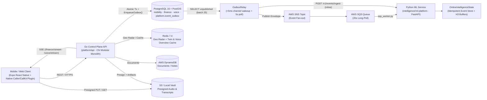
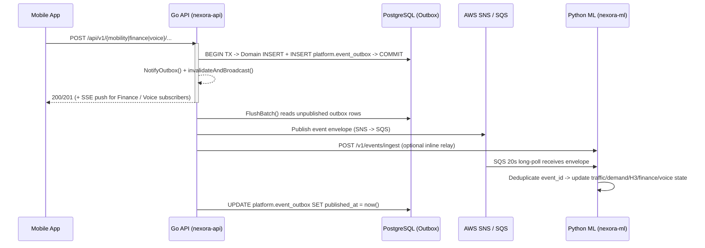

# NEXORA

Intelligent life platform unifying **Mobility (MoveSmart)**, **Wealth & Finance**, **Voice & Call Notes**, **Copilot**, **Health**, and **Work** on an event-driven architecture.

## Architecture Overview

NEXORA separates **transactional state and control plane** (Go + PostgreSQL/PostGIS + Redis) from **online learning and inference** (Python + FastAPI), connected asynchronously through a **Transactional Outbox → AWS SNS/SQS (or local relay) → Online Intelligence Consumer** pipeline, with **Server-Sent Events (SSE)** for real-time client updates across Finance and Voice.



## Core Domain Modules

### 1. Mobility — MoveSmart (`platform/api/internal/modules/mobility`, `apps/mobile/src/features/move`)
- Turn-by-turn navigation, live corridor telemetry, traffic anomaly detection, road hazard reporting, and H3 spatial hotspot & demand forecasting (`traffic_forecaster.py`, `demand_forecaster.py`, `eta_engine.py`, `city_digital_twin.py`).

### 2. Wealth & Finance (`platform/api/internal/modules/finance`, `apps/mobile/src/features/finance`)
- Net worth & financial digital twin, multi-account ledger & UPI/bank alert parsing, tax regime & LRS planning, AI CFO insights, Redis twin cache invalidation (`fin:twin:v1:<userID>`), and real-time SSE push (`/api/v1/finance/stream`).

### 3. Voice & Call Notes (`platform/api/internal/modules/voice`, `intelligence/ml-platform/src/nexora/voice`)
- **Capture & Streaming Sessions**: Quick notes, audio uploads via presigned S3 PUT/GET (`s3_presign.go`), dual-track live call/meeting streaming sessions (`/voice/sessions/*`), and downloadable transcript/audio artifacts (`GET /api/v1/voice/conversations/{id}/download`).
- **Speech & Understanding Pipeline**: VAD/SNR audio quality routing (`audio_pipeline.py`), speaker clustering & interaction dynamics (`speech_engine.py`), commitments/decisions/knowledge graph extraction, contradiction reasoning, and source-grounded Q&A (`understanding_engine.py`, `ir.py`).
- **Native Caller ID & Call History**:
  - Phone numbers are SHA-256 hashed and masked (`caller_directory.go`, `call_logs.go`) before persistence in `voice.caller_directory` and `voice.call_logs`.
  - **Android**: `READ_CALL_LOG` historic call sync + `CallScreeningService` (`NexoraCallerIdModule.kt`, `withNexoraCallerId.js`).
  - **iOS**: `CNContactStore` contacts sync + CallKit `CXCallDirectoryProvider` & live `CXCallObserver` (with CSV/JSON export support for historic logs).
- **Cryptographic Provenance**: SHA-256 digest, HMAC seal, utterance Merkle root, hash-chained `voice.custody_events`, and Legal Hold controls (`crypto.go`).

### 4. Cross-Domain Copilot (`apps/mobile/src/features/assistant`)
- Unified conversational assistant routing across Mobility, Wealth, Voice & Call Notes, Health, and Work with explainability factors, citations, and privacy-gated context toggles.

### 5. Unified Deep Learning & Continuous Verification Platform (`intelligence/ml-platform/src/nexora/deep_learning`, `intelligence/evaluation`)
Comprehensive production deep learning suite covering 16 specialized neural architectures across all four pillars:

- **🚗 Mobility Deep ML**:
  - `SpatioTemporalGNN`: 2-hop bidirectional spatial diffusion + dilated gated temporal convolutions (TCN) forecasting 5, 15, 30, and 60-min segment speeds (`POST /v1/deep/mobility/st-gnn/predict`).
  - `DeepConformalETAPredictor`: Calibrated residual MLP providing finite-sample guaranteed 80% & 90% conformal coverage intervals (`POST /v1/deep/mobility/eta/conformal`).
  - `TrajectoryTransformer`: Multi-head self-attention encoder predicting trip destinations from breadcrumbs (`POST /v1/deep/mobility/trajectory/predict`).
  - `TripAnomalyAutoencoder`: Sequence autoencoder scoring route detours and trip outliers via reconstruction error.
  - `NeuralRoadVision`: DINOv2-style surface defect classifier (pothole, waterlogging, flood) with monocular crater depth estimation (`POST /v1/deep/mobility/vision/inspect`).
  - `BehavioralDemandTFT`: Temporal Fusion Transformer sequence model with distance-attenuated event surge modeling (`POST /v1/deep/mobility/demand/forecast`).
  - `OfflineRLPolicySimulator`: Conservative Q-learning policy evaluation for digital twin signal & routing what-if experiments (`POST /v1/deep/mobility/policy/evaluate`).

- **💰 Finance Deep ML**:
  - `NeuralTransactionClassifier`: MiniLM / DistilBERT-style subword transformer classifier for SMS and alert text (`POST /v1/deep/finance/classify-alert`).
  - `DeepSVDDAnomalyDetector`: Deep Support Vector Data Description hypersphere anomaly detector for spend fraud and unusual spikes (`POST /v1/deep/finance/anomaly`).
  - `DeepARCashFlowForecaster`: Autoregressive sequence model predicting 30/60/90-day balance trajectories ($p10, p50, p90$) (`POST /v1/deep/finance/cashflow-forecast`).
  - `RegimeSwitchingRiskModel`: Hidden Markov 4-state regime switcher (Bull, High Volatility, Mean Reverting, Liquidity Squeeze) with Indian equity factor tilts (`POST /v1/deep/finance/regime-risk`).
  - `GNNRiskPropagator`: Message-passing shock propagation across equity, debt, floating loans, and deposits (`POST /v1/deep/finance/graph/propagate`).
  - `NeuralDocIntelligence`: Transformer parser extracting PAN, IFSC, salary slips, and tax forms (`POST /v1/deep/finance/doc/extract`).

- **🎙️ Voice Deep ML**:
  - `WhisperTelephonyASRAdapter`: Acoustic SNR compensation, telephony codec selection, and Hinglish/Tenglish code-switching detection (`POST /v1/deep/voice/asr/adapt`).
  - `NeuralSpeakerDiarizer`: 16-dim neural x-vector speaker embeddings with agglomerative cosine clustering (`POST /v1/deep/voice/diarize`).
  - `DenseMemoryRetriever`: BGE-M3 dual-encoder dense semantic retrieval across conversation transcripts (`POST /v1/deep/voice/dense-search`).
  - `CrossEncoderReranker`: Cross-attention joint query-passage reranker for grounded QA (`POST /v1/deep/voice/rerank`).
  - `AcousticUrgencyEmotionDetector`: Wav2Vec2/HuBERT affect classifier & caller escalation risk detector (`POST /v1/deep/voice/urgency`).

- **🌐 Cross-Cutting & Continuous Learning**:
  - `MultiModalUserTwinFusion`: Fuses Voice, Finance, and Mobility into a unified 32-dim latent user twin with cross-modal behavioral correlation discovery (`POST /v1/deep/multimodal/user-twin`).
  - `DriftDetector`: Two-sample Kolmogorov-Smirnov continuous feature drift detector (`POST /v1/deep/evaluation/drift`).
  - `ModelEvaluationHarness` & `intelligence/evaluation/benchmark.py`: Continuous verification suite testing MAE, RMSE, MAPE, empirical conformal coverage, and shadow-mode latency overhead.

## Event-Driven Flow

1. **Atomic Write + Outbox Enqueue (`platform/api`)**
   - Every domain mutation (`mobility/repository.go`, `finance/repository.go`, `voice/repository.go`) writes its business row and calls `events.EnqueueOutbox(...)` inside the **same PostgreSQL transaction**, guaranteeing zero lost events on crash.
   - `EnqueueOutbox` inserts into `platform.event_outbox` and calls `NotifyOutbox()` (non-blocking buffered channel) to wake `OutboxRelay` immediately (`<5 ms`), backed by a 5-second fallback ticker.

2. **Relay & Envelope Wrapping (`platform/api/internal/platform/events/outbox.go`)**
   - `OutboxRelay.FlushBatch` reads up to 25 unpublished rows (`published_at IS NULL AND attempts < 10`), wraps each in the standard `contracts/events/envelope.schema.json` format (`event_id`, `event_type`, `schema_version`, `occurred_at`, `ingested_at`, `producer`, `payload`), and delivers it to:
     - **AWS SNS** (`SNS_EVENTS_TOPIC_ARN`, SigV4-signed HTTPS `Publish` with `event_type` attribute) → **AWS SQS** (`SQS_INTELLIGENCE_QUEUE_URL`).
     - **ML HTTP Ingestion** (`POST /v1/events/ingest`) when `ML_SERVICE_URL` is configured for sub-second local/direct propagation.
   - Failed deliveries increment `attempts` and record `last_error` for retry; successful deliveries stamp `published_at`.

3. **Idempotent Online Intelligence (`intelligence/ml-platform/src/nexora/events/sqs_worker.py`)**
   - `run_sqs_consumer_loop` long-polls SQS (`WaitTimeSeconds=20`, `MaxNumberOfMessages=10`) while `/v1/events/ingest` accepts direct HTTP relays.
   - `OnlineIntelligenceState.handle_event` deduplicates via `event_id`, unwraps SNS envelopes if present, routes by `event_type`, checkpoints state to disk, and updates live models in memory:
     - `traffic.observed.v1` → updates `SpatioTemporalTrafficForecaster` segment speeds
     - `location.observed.v1` / `location.batch` → cleans trajectories, indexes H3 cells, updates `MobilityDemandForecaster` & hotspot discovery
     - `trip.started.v1` / `trip.completed.v1` / `route.feedback.v1` → updates demand & route quality feedback
     - `hazard.reported.v1` → updates active road hazard ring buffer
     - `finance.*` → feeds cross-domain finance event stream
     - `voice.*` → feeds voice intelligence event stream

4. **Cache Invalidation & Real-Time UI Push (`Redis` + `SSE`)**
   - Finance and Voice mutations call `invalidateAndBroadcast(ctx, userID, event)`, which deletes the cached snapshot (`fin:twin:v1:<userID>` or `voice:overview:v1:<userID>`) in Redis and pushes an event onto per-user subscriber channels streamed over `GET /api/v1/finance/stream` and `GET /api/v1/voice/stream` (SSE).
   - Mobility trip breadcrumbs update Redis spatial geo sets for low-latency nearby active-trip radar queries.



### Event Contracts (`contracts/events/`)

| Event | Producer | Consumer Effect |
|---|---|---|
| `trip.started.v1` | Mobility Repository | Seeds H3 demand ping at trip origin |
| `location.observed.v1` | Mobility Repository | Trajectory cleaning, H3 hotspot & demand updates |
| `trip.completed.v1` | Mobility Repository | Trip telemetry completion & duration metrics |
| `route.feedback.v1` | Mobility Repository | Route recommendation feedback loop |
| `hazard.reported.v1` | Mobility Repository | Updates active corridor hazard buffer |
| `traffic.observed.v1` | Mobility Telemetry | Updates spatio-temporal segment speed state |
| `transit.updated.v1` | Transit Feed | Updates stop arrival / freshness signals |
| `prediction.generated.v1` | Intelligence Service | Records generated forecast metadata |
| `finance.transaction.ingested.v1` | Finance Repository | Streams new financial activity to ML & SSE |
| `voice.recording.captured.v1` | Voice Repository | Records new voice/call capture metadata |
| `voice.audio.analyzed.v1` | Voice Pipeline | Publishes VAD/SNR acoustic quality metrics |
| `voice.speech.transcribed.v1` | Voice Pipeline | Publishes speaker-attributed utterances |
| `voice.conversation.understood.v1` | Voice Pipeline | Publishes decisions, commitments & entities |
| `voice.action.suggested.v1` | Voice Pipeline | Publishes human-in-the-loop follow-up suggestions |
| `voice.evidence.sealed.v1` | Voice Vault | Publishes Merkle root & custody seal verification |
| `work.task.created.v1` | Work Module | Task lifecycle envelope |

---

## Tech Stack

| Layer | Technology |
|---|---|
| Mobile / Web | React Native (Expo) + TypeScript + React Query + Zustand + Native Caller/CallKit Config Plugin |
| Control-Plane API | Go + Chi modular monolith (`platform/api`) |
| Intelligence & ML | Python + FastAPI + PyTorch / NumPy / SciPy + Spatio-Temporal GNN + Conformal Predictors (`intelligence/ml-platform`, `intelligence/evaluation`) |
| Primary DB | PostgreSQL 16 + PostGIS (per-module schemas `0001`–`0007` + transactional outbox) |
| Cache & Geo | Redis 7.4 |
| Event Bus | PostgreSQL Outbox → AWS SNS / SQS (or Redpanda/Kafka locally) |
| Document Store | AWS DynamoDB (serverless HTTPS) |
| Object Storage | MinIO (local) / AWS S3 (presigned PUT/GET) |
| Observability | Prometheus + Grafana |

## Repository Layout

```
apps/mobile/                Expo React Native app (Home, Explore, Copilot, Profile + Mobility, Finance, Voice & Privacy workspaces + plugins/withNexoraCallerId.js)
platform/api/               Go modular monolith API (platform, identity, outbox, cache, mobility, finance, voice, health, work + migrations 0001-0007)
intelligence/ml-platform/   FastAPI ML inference service, Deep Learning Hub (16 models), SQS event consumer, geospatial, finance & voice intelligence engines
intelligence/evaluation/    Continuous learning verification & benchmark harness (drift detection, conformal empirical coverage, latency benchmarks)
contracts/                  OpenAPI v1 spec (contracts/openapi/) + JSON event schemas (contracts/events/)
infra/                      AWS SAM/Docker deploy templates, Postgres, Prometheus, Grafana configs
scripts/                    Deployment & ops helper scripts (deploy-aws.sh)
docs/                       Architecture blueprint, ADRs, runbooks
```

---

## Quick Start

### 1. Local Full Stack (Docker Compose)

```bash
cp .env.example .env
make up           # starts postgres, redis, redpanda, minio, api (:8080), ml (:8000), prometheus (:9090), grafana (:3000)
make ps

# Health checks
curl http://localhost:8080/api/v1/healthz
curl http://localhost:8000/healthz
```

### 2. Run Mobile / Web Client

```bash
cd apps/mobile
npm install
npm run web       # or npm run ios / npm run android
```

### 3. Tests, Typecheck & CI

```bash
make ci           # runs api-test (go vet + go test -race), ml-test (pytest), mobile-test (tsc --noEmit) & lint
make api-test     # cd platform/api && go vet ./... && go test -race ./...
make ml-test      # cd intelligence/ml-platform && python3 -m pytest -v
make mobile-test  # cd apps/mobile && npm run typecheck
make fmt          # cd platform/api && go fmt ./...
```

### 4. AWS Free-Tier Deployment

Requires `.env.aws` (see `infra/aws/env.aws.example`):

```bash
make aws-deploy   # provisions/updates stack & deploys api + ml
make aws-status
make aws-logs
```

## Conventions

- **Contracts first:** `contracts/openapi/nexora-v1.yaml` and `contracts/events/` are the sources of truth.
- **Boundary separation:** Go owns business logic, persistence, and outbox transactions; Python owns inference and online learning.
- **Privacy by design:** Never log raw GPS coordinates, phone numbers, bank account numbers, PAN, Aadhaar, or unmasked UPI IDs.
